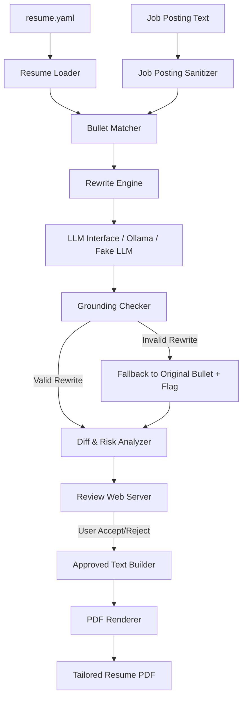

# Architecture Proposal: Local-First Resume Tailoring Agent

## 1. Components
- **Resume Loader**: Loads `resume.yaml`, validates schema via Pydantic, and enforces file constraints (e.g., max 100 KB size, unique bullet IDs).
- **Job Posting Sanitizer**: Strips invisible control characters and HTML tags from untrusted job posting text and enforces character length limits.
- **Bullet Matcher**: Computes vector embedding similarity using local `sentence-transformers` to pair resume bullets with relevant job posting sections.
- **LLM Adapter & Interface**: Abstracts the LLM client behind a standard interface supporting local Ollama execution and a test Fake LLM model.
- **Rewrite Engine**: Constructs system prompts and sends paired bullet data to the LLM interface, enforcing structured JSON output.
- **Grounding Checker**: Validates rewritten bullets against trusted resume data, rejecting rewrites that invent new facts, skills, entities, or metrics.
- **Diff & Risk Analyzer**: Computes word-level visual diffs and flags potentially risky wording changes (e.g., action verbs, numbers, tools).
- **Review Web Server**: Serves a local-only web interface on `127.0.0.1` protected by a random token and `Host` header checks for accept/reject review.
- **PDF Renderer**: Compiles approved text strictly into a final PDF file without loading external assets or retaining temporary data.

## 2. Data Flow



1. **Input Ingestion**: `resume.yaml` is parsed and validated by the Resume Loader. Untrusted job posting text is cleaned by the Job Posting Sanitizer.
2. **Matching**: The Bullet Matcher calculates semantic relevance between resume bullets and job posting requirements using local `sentence-transformers`.
3. **LLM Rewriting**: The Rewrite Engine formats matching context and queries the LLM Interface (Ollama or Fake LLM) enforcing a JSON response schema.
4. **Grounding Validation**: The Grounding Checker validates the returned JSON. Valid rewrites proceed to diffing; invalid rewrites default to the original bullet with a warning flag.
5. **Diff & Risk Computation**: Text diffs and risk badges (e.g., new numbers, tools, leadership words) are generated.
6. **Interactive Review**: The Review Web Server launches on `127.0.0.1` with a random access token and Host header check. The user manually accepts or rejects each change.
7. **PDF Generation**: Once 100% of bullets are reviewed, the PDF Renderer builds the final PDF strictly from approved text. Zero state is persisted.

## 3. Trust Boundaries

- **Boundary 1: Job Posting Input (Untrusted Input → Job Posting Sanitizer)**
  - *Control*: HTML tags and control characters are stripped. Text is limited to 20,000 characters and treated purely as passive data strings within LLM prompt contexts.
- **Boundary 2: LLM Output (Semi-Trusted AI Response → Grounding Checker)**
  - *Control*: Strict JSON schema validation via Pydantic. Automatic grounding rules verify original bullet references and reject any new entities, dates, titles, skills, numbers, or contact info, falling back to original bullets on failure.
- **Boundary 3: Browser HTTP Requests (Untrusted Web Client → Review Web Server)**
  - *Control*: Web server binds strictly to `127.0.0.1`, validates `Host` headers (`127.0.0.1` or `localhost`), and requires a cryptographically random session token in requests.
- **Boundary 4: Approved Text (User Review UI → PDF Renderer)**
  - *Control*: PDF renderer strictly escapes all text, prohibits external network/asset requests, and prevents arbitrary code execution.
- **Boundary 5: Resume File (Trusted Input → Resume Loader)**
  - *Control*: Safe YAML parsing (`yaml.safe_load`), checking max file size (< 100 KB), and verifying bullet ID uniqueness and schema completeness via Pydantic.

## 4. Suggested Layout

```
/src
  /config
  /models
  /parsers
  /matchers
  /llm
  /grounding
  /diffing
  /web
  /pdf
  /cli

/tests
  /unit
  /integration
  /fakes
  /fixtures
```

## 5. Top 5 Design Risks & Mitigations

1. **LLM Fact Hallucination / Skill Inflation**:
   - *Mitigation*: Automated grounding checker compares rewritten text against original bullet data and approved skills list, falling back to original bullets if unauthorized facts are detected.
2. **Prompt Injection from Untrusted Job Posting Text**:
   - *Mitigation*: Enclose job posting text within isolated data delimiters, enforce JSON schema decoding, and rely on downstream grounding validation rather than prompt adherence alone.
3. **Unauthorized Local Web Access / Cross-Site Request Forgery (CSRF)**:
   - *Mitigation*: Bind review web server exclusively to `127.0.0.1`, enforce strict `Host` header checks, and require a single-use random access token generated at runtime.
4. **Supply Chain Attacks via External Packages/Models**:
   - *Mitigation*: Pin exact dependency versions, download exclusively from official repositories (PyPI, Hugging Face, Ollama), and run security scanners (`gitleaks`, `bandit`, `pip-audit`) in CI.
5. **Residual Sensitive Data Left on Disk/Logs**:
   - *Mitigation*: Process all data in-memory, suppress sensitive content from logs, and ensure no database or temporary files remain after PDF rendering.

## 6. Questions Regarding Design Gaps

1. How should the grounding check reliably distinguish between new unapproved skills vs. standard grammatical rewordings when a skill isn't listed in the root `skills` array?
2. What is the expected behavior if an LLM rewrite alters the structural layout (e.g., suggesting bullet merging, splitting, or reordering across sections)?
3. How should the system handle job postings that exceed the 20,000 character limit or contain non-English content?
4. What happens if the user closes their browser tab during review—should the server terminate immediately, or remain open until a configurable timeout?
5. What specific PDF visual layout, styling, and font requirements should the PDF Renderer conform to?

## 7. Requirement Inconsistencies & Testing Challenges

- **Testing Prompt Injection without Live LLM**: Testing Rule 2 requires verifying that adversarial prompt injections in job postings do not alter system instructions, which is difficult to test reliably using deterministic Fake LLM mocks.
- **Skill Detection Precision**: Rule 5 / Decision 3 state that new skills must not be added, but detecting whether a reworded phrase introduces a "new skill" requires semantic NER matching which can lead to false positives on common vocabulary.
- **Guaranteed Zero Disk Footprint**: Guaranteeing zero temporary files left behind (Rule 11) is hard to strictly verify or enforce if third-party libraries (e.g., PDF generation or sentence-transformer model loading) create ambient cache files.
- **All Changes Reviewed Requirement**: Rule 8 requires that every change must be accepted or rejected before enabling the PDF export button, but does not clarify the UI flow when the AI suggests 0 changes or when all rewrites fail grounding checks.

---

*Assumptions*:
- Assumption: The user environment has a local Ollama instance pre-configured with the required model for production execution.
- Assumption: The test execution environment in CI/CD runs fully headless without access to local Ollama, relying entirely on Fake LLM adapters.
- Assumption: `resume.yaml` contains a top-level `skills` list that defines the complete set of valid skills for grounding validation.
- Assumption: All job posting sanitization, vector matching, LLM invocation, and diffing happen synchronously prior to serving the web review UI.
- Assumption: The PDF engine can render formatted text using built-in standard fonts without loading external web fonts or asset files.
